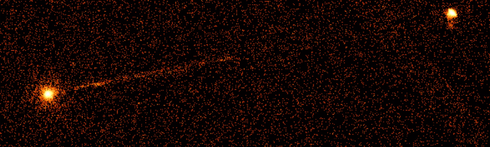

::: {.hero}

```{=html}

```

::: {.hero-inner}
::: {.hero-kicker}
Professor of Astrophysics · University of Bristol
:::

# Andrew Young

::: {.hero-lead}
Numerical and observational studies of accreting black holes — from general
relativistic spectral models to X-ray observations.
:::

::: {.hero-actions}
[About](about.qmd){.primary}
[Publications](publications.qmd){.secondary}
[Group](people.qmd){.secondary}
[ORCID](https://orcid.org/0000-0003-3626-9151){.secondary}
:::

::: {.hero-credit}
Pictor A · Chandra X-ray Observatory · NASA/UMD/A. Wilson et al.
:::
:::
:::

::: {.home-below}
::: {.intro-row}
```{=html}

```

::: {.intro-copy}
Professor in the School of Physics at the University of Bristol. Research on black hole accretion, X-ray spectroscopy, and general relativistic models of discs and coronae.
:::
:::

::: {.home-panels}
::: {.section-block}
## Latest news

:::{#home-news}
:::

[All news →](news/index.qmd)
:::

::: {.section-block}
## Group



[People →](people.qmd)
:::
:::

::: {.section-block .last-updated}

:::
:::
