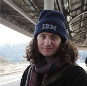

Congratulations to [Dr Fergus Baker](https://cosroe.com/) on receiving the University of Bristol’s [Vice-Chancellor’s Prize for Best Doctoral Thesis](https://www.bristol.ac.uk/doctoral-college/news/2026/dr-fergus-baker-wins-vice-chancellors-prize-for-best-doctoral-thesis.html).

{fig-alt="Portrait of Dr Fergus Baker" width="180" fig-align="left"}

Fergus’s thesis, *General relativistic effects in black hole X-ray coronal models*, was supervised by me and Dr Sotiria Fotopoulou. His examiners highlighted the novel physical insights, mathematical and computational techniques, and the software package he released for the community.

You can read his thesis here: [General relativistic effects in black hole X-ray coronal models](https://cosroe.com/thesis.html). The source code is also there so you can see how the figures were made. The thesis is a work of art and an excellent introduction to the field. Well done Fergus, we're very proud of you!

Fergus is now a postdoctoral researcher at Durham.
